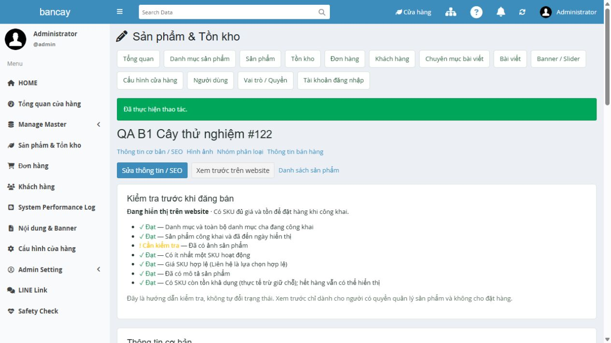
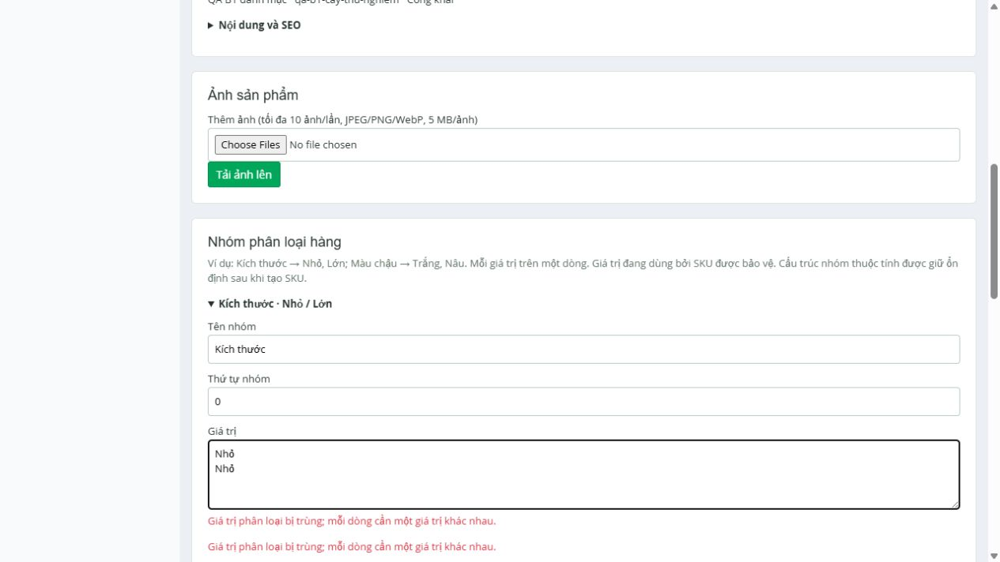
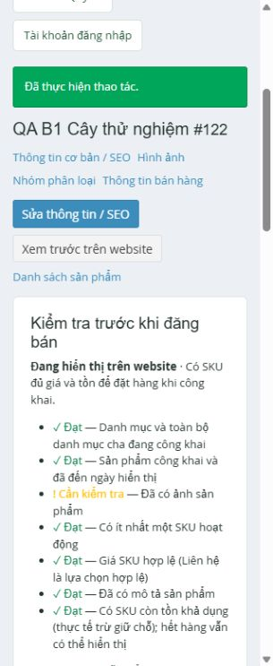

# Option B — Admin UX implementation

## Authorization and baseline

User instruction **“thực hiện theo đề xuất”**, then **“tiếp tục”**, authorizes incremental Option B from the [review](../../reviews/improvement-options.md). It supersedes the earlier review-only restriction for this implementation. B1 is implemented; B2 has an isolated native-widget feasibility prototype and an explicit adoption decision below. The broader C/post-release backlog is outside this change.

- Git baseline: `93c581c3976b41d7bcfcf6f44313d11073da8cdb`, branch `feature/develop`.
- Uncommitted at start: README/AGENTS review pointers, `docs/reviews/`, `docs/business-ui-remediation/adminreview-20261030/`. They are preserved. Implementation remains uncommitted.
- Current stack: Exment 7.0.0 / admin-core 1.0.1 / Laravel 12.70.2 / PHP 8.3.36 / MariaDB 10.11.19. No dependency/schema upgrade.
- Main data: combined demo + migrated catalog. Test writes use `bancay_test` and the checksum-verified owned clone `bancay_release_candidate_20261030_003` at localhost:8004. No source/stage/main business writes, importer replay or production action.
- Inputs: Master Plan; current Admin review/backlog/roadmap/native assessment; current StoreResources, StoreController, CatalogEditor, StoreQueries, Publication/Catalog/Seo/ContentHtml, commerce Actions and tests; pinned native Form/Grid/Initialize/Bootstrap source.

## Implemented changes

| ID | Before | Implemented behavior | Verification |
|---|---|---|---|
| AR01 |Option errors replaced attempted values with persisted values |Server-generated product/group flash marker; failed group opens, keeps name/order/newlines and escaped input; inline Vietnamese errors and autofocus to the invalid field. Other groups/products stay separate |Duplicate new/existing groups, used values, rollback/IDs; UI focused `values`, `aria-invalid=true`, other group's `Trắng/Nâu` retained |
| AR02 |Raw status codes, English field names, unclear requirements |Shop status label map, Vietnamese SEO labels and common validation messages/aliases, required markers, slug/publication/HTML/SEO help. Stored enum values and native locale unchanged |Form/list/detail/order/customer/dashboard render tests; native form create/save UI |
| AR03 |No consolidated publication/sellability check or draft preview |Advisory checklist for ancestor publication/date/images/active SKU/price/content/available stock; authenticated storefront preview at the existing product admin URL with `?preview=1` |Product-manager allowed, guest redirected, content-manager403; public draft404 and cart rejection; CONTACT valid; no buy controls, noindex/nofollow, private/no-store |
| AR04 subset |Generator effect unclear before submit |Bounded combination count from saved groups, existing SKU count and inactive/CONTACT/zero-stock defaults explained |Two groups×two values →4; generator/matrix UI and existing bounded/additive tests |
| AR08 |No inventory availability filter |Out `≤0`, low `1–5`, available `>0`; all based on physical minus reserved, shared by list/CSV. Threshold constant used in dashboard |Zero/fully-reserved/5/6 boundaries, invalid filter422, filtered CSV, browser rows3 out/1 available |
| AR09 |Cancel selected and immediately submitted |Separate cancel section shows order number/quantity/effect, explicit checkbox validated server-side; normal workflow excludes cancel |Missing confirm422, confirmed cancel, replay/stale rejection; physical10/reserved2→0, immutable100000 snapshot, history. Reason stays optional per existing policy |
| AR15 |Published KPI ignored hidden ancestors; recent mixed legacy/live |Same Publication ancestor/date scope as storefront; live-only recent queue and counters; origin filter/legacy badges; dashboard stock/queue links; supported native navbar shortcut |Baseline main clone121 products/119 public; synthetic published product adds1; role-scoped tests and native shortcut UI |

Checklist is guidance, not a new publication policy. Missing images/content/stock do not silently reprice, unpublish or forbid legitimate CONTACT products. Preview uses the actual storefront template and sanitized HTML, exposes only active SKU data and has no cart submission controls. Public publication/cart/checkout checks remain mandatory. Reload product detail after saving the AJAX matrix to refresh its checklist.

No changes to the 17 business schemas, plugin UUIDs/grants, order Actions, stock rules or snapshot/history contracts. No runtime plugin reconfiguration required: preview uses an existing protected GET route. Old open cancel forms receive422 until refreshed and explicitly confirmed.

## B2 — native feasibility and decision

`NativeCategoryPrototypeTest` uses **the installed native Eloquent Form/Grid APIs** in the isolated test DB:

1. Native Grid reads the existing Category rows and keeps IDs, with mutation/export controls disabled in the prototype.
2. Native Form's supported `saving()` Response hook delegates create/update to RecordEditor and stops generic ORM writes; one row remains one row.
3. Existing tree-cycle rejection rolls back; catalog Gate rejects Content Manager.

Three tests /12 assertions pass. No prototype route/CustomTable/model mirror/runtime registration is added. This proves the integration seam, not full replacement parity. Upload, full field/form errors, PJAX, CSRF/HTTP routing, filtered export and role/menu parity of a native replacement remain **NOT TESTED**. Current generic metadata already shares simple CRUD across modules; introducing a second active Category adapter before that parity evidence adds a write path and does not establish a maintenance benefit. **Decision: retain current runtime adapter; keep B2 adoption/AR17 route refactor deferred, non-blocking.** Six plugins keep their current permission boundaries. No LOC/time/click savings claimed.

## Verification

- Automated final results: **191 PHP tests /1300 assertions and5 JavaScript tests PASS**, Pint/Composer validate/platform/Exment checks/build PASS; Composer0 advisories/0 abandoned, npm0 vulnerabilities. [checks.json](evidence/checks.json). Full suite includes Phases1–5, business UI, B1 and native prototype; no failed/skipped tests in the final run.
- Browser: [22-case IAB matrix](evidence/browser-results.json). Synthetic category15, product122, four SKU143–146, order260 exist only on the disposable QA clone.
- Admin→create category/product→two option groups→4 SKU→price100000/stock10→publish→frontend checkout quantity2/total200000→admin confirm→cancel→history verified. Final read-only DB checks: [qa-verification.json](evidence/qa-verification.json).
- Responsive: admin320/768px and preview390px have no document overflow; matrix scroll remains inside its region. Desktop and preview images below. Admin/preview/checkout console error lists were empty.
- Current browser inventory exposes IAB and MCP Apps only. **External Chrome/Edge and Safari/iOS NOT TESTED** in this run. IAB is not labelled Chrome/Edge. Role rejection and invalid/tampering/replay cases are automated HTTP tests; fresh browser role assignment is not claimed.
- Initial added test assertions were corrected for JSON Unicode encoding and Exment `require_once` bootstrap behavior in a long-lived PHPUnit process; no failed assertion was skipped. Native shortcut also verified on an actual fresh browser request. Pint formatting corrected before final checks.

## Preservation and rollback

The existing QA helper verifies all98 base tables before clone tests; coherent source-copy bytes/SHA-256 and ownership are in [QA receipt](../../business-ui-remediation/admin-b1-20261030/evidence/qa-environment.json). Raw SQL/env/logs/media stay private under ignored `legacy-private/`. Original backups/CI3/source8002 are untouched. Cleanup verified **all main tables except `admin_operation_log` unchanged, all staging tables unchanged, all17 business tables unchanged**. The native main audit-log difference has no inferred origin and no rows were reverted. Owned QA container/database/account removed: [cleanup receipt](../../business-ui-remediation/admin-b1-20261030/evidence/cleanup.json).

Rollback is code-only: revert B1 application/views plus native bootstrap shortcut, rebuild Vite assets and reload admin pages. No DB down migration/data restore or account/grant reset is needed. Retain the pre-existing review documents/evidence and user-owned `admin`/`local-admin` accounts.

## Remaining work and readiness

| Item | Status | Release meaning |
|---|---|---|
| AR01/02/03/08/09/15 B1 implementation |IMPLEMENTED / technical verification in linked artifacts |Ready for staff UAT; no automatic business acceptance |
| AR04 combination preview subset |IMPLEMENTED |Row/chip authoring redesign remains optional backlog |
| AR16 native seam PoC |VERIFIED FEASIBILITY; runtime adoption DEFERRED NON-BLOCKING |Full parity required before adapter replacement |
| AR17 shared route/controller refactor |DEFERRED NON-BLOCKING |No route/plugin-ID rewrite in B1 |
| BA-G04 / staff real-catalog UAT |PENDING / existing gate |Owner has no launch SKU/price/stock/photos yet; no fabricated approval |
| BA-V01 |BLOCKER / existing acceptance gate |Fresh external Chrome/Edge current-build evidence still needed |
| P5-B01/B02/B03 |BLOCKER / existing production gates |Actual coherent production backup/CI3 rollback, DirectAdmin target profile and final-source/freeze/candidate rehearsal remain absent |

**PHASE 6 STATUS: NOT READY.** B1 UX improvements do not close independent business/browser/hosting gates. No DNS, docroot, CI3, production migration or production traffic changes.
