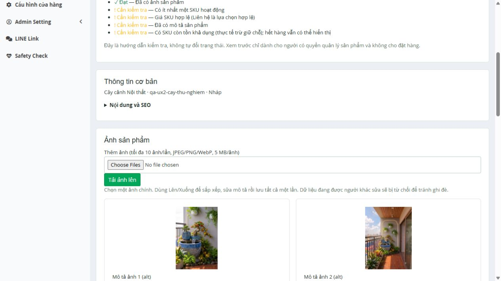
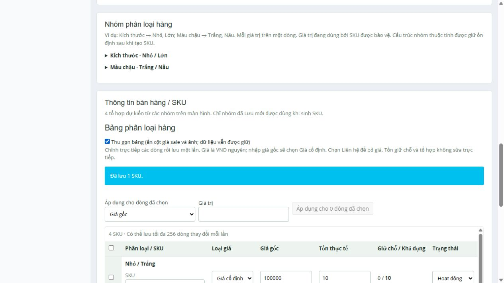

# Admin UX — iteration 2 (31/10/2026)

> Later verification: [UI acceptance31/10](../ui-acceptance-20261031/report.md) fixes five reproduced form/validation issues and verifies20 current IAB case groups, including gallery, queue, Back/dialog,256-row keyboard and responsive checkout.201 PHP/1392 assertions +5JS/build/Pint/audits0 PASS. Native refresh/close and standalone Chrome/Edge remain unverified; full sign-off and Phase6 remain NOT READY. The report below is the original iteration checkpoint; its evidence is unchanged.

**IMPLEMENTED / UI VERIFICATION INCOMPLETE. PHASE 6 STATUS: NOT READY.**

User authorized continuing the recommendation after B1. This iteration implements the next UX items without changing commerce policy, schema, native identities/grants or production. It preserves the uncommitted B1/review work; no commit/push is performed.

## Baseline and isolation

- Git baseline remains `93c581c3976b41d7bcfcf6f44313d11073da8cdb`, `feature/develop`, with B1 and review changes uncommitted at start. [B1 evidence](../b1/report.md) stays historical and unchanged.
- Exment7.0.0 / admin-core1.0.1 / Laravel12.70.2 / PHP8.3.36 / MariaDB10.11.19. No new packages or schema migrations.
- Inputs: Master Plan, review backlog/roadmap, B1 status, actual native bootstrap/Form/Grid sources, current upload/option/order/query/publication/preview services and existing tests.
- Native UI writes only on owned `bancay_release_candidate_20261031_001`, localhost8004, cloned and checksum-verified across98 base tables. Automated destructive tests use guarded `bancay_test`, serially.
- Original demo/migrated rows, user-owned admin/local-admin identities, source/stage and production are preserved. No importer, production DB, DNS/docroot or cutover action.

## Changes

| Backlog | Implementation | Evidence / remaining verification |
|---|---|---|
| AR04 |Progressive per-value rows with add/remove, accessible labels, multi-line mode,100-value limit and bounded unsaved combination count. Original textarea payload/service/used-value protections retained |IAB entered two rows, multi-line second group and generated4 SKUs. Backend existing duplicate/used-value/additive generation regression PASS. Final overflow rendering guard needs browser verification |
| AR05 |SKU thumbnail follows selected own-product image/cover; sticky identity/header; compact toggle hides optional image/sale columns without removing values |IAB saved SKU image/price/stock and toggled compact; dirty remained false and image loaded. Sticky/responsive/256-row keyboard checks NOT TESTED in this iteration |
| AR10 |Status tabs; whitelist-only queue context preserves search/date/status/origin/sort/page through detail/status-submit/back link. Next query follows matching sort and only live open orders, never imported history |HTTP tests PASS for context/redirect, invalid context422, bounded oldest/newest/filter next behavior and legacy exclusion. Manual queue flow NOT TESTED |
| AR11 |Banner placement/size/schedule/priority help and links to existing storefront locations; shop settings help/labels |Source/HTTP rendering reviewed. Dedicated category/popup slots are explicitly marked unsupported. QA snapshot has only1 active home_slider, so no active banner is silently dropped by this distinction. Manual banner preview NOT TESTED |
| AR12 |Role-scoped task shortcuts on dashboard; explanation of profile/login/role distinctions and least privilege |HTTP Content Manager/Product Manager/Order Manager checks and existing permission regression PASS. No native grants changed; staff UAT remains pending |
| AR19 |Whole-gallery metadata save, one primary, reorder Up/Down controls usable by keyboard, alt text, stale HMAC receipt, complete-owner-set validation, atomic transaction |IAB uploaded2 authorized idea images to synthetic product, moved image up, set alt/primary and saved once. HTTP same-primary/switch/stale/duplicate/missing/foreign/forbidden/path-tampering tests PASS. Pointer drag is deferred; Up/Down is implemented |
| AR06 subset |Private saved draft Article preview using actual storefront rendering/sanitizer, null publish-date safe; saved SEO snippet uses actual storefront fallback formatter |HTTP guest redirect/role403/public404/noindex/sanitized HTML/no publication mutation and SEO equality PASS. Visual rich-text editor remains deferred; source HTML is preserved |
| AR18 |Shared unsaved-state tracking for option/forms/gallery/matrix, in-page accessible leave/stay dialog for link/form/PJAX, native beforeunload fallback |Final JS syntax PASS. **Final dialog interactions, cancel/accept, history/PJAX/back/refresh/close NOT VERIFIED** after provider interruption. Do not treat this item as resolved |

Services: `ProductImages::batch/version` performs owner/receipt validation under product/gallery locks, validates all rows before writing, resets then establishes one primary and never accepts file paths or deletes files. Digest uses the locked collection, avoiding stale consistent-read comparisons. Old single-image/upload/delete actions remain available. Gallery limit200 is a technical batch bound; larger galleries retain individual editing. No stock/price/snapshot/status field is writable through image metadata.

Order context never accepts a return URL; only allowed scalar filter keys survive validation. Navigation is read-only, authorized by the existing commerce Gate. Status changes continue through ChangeOrderStatus. Read-only URL formatting in the view does not query DB.

Native Form/Grid replacement remains at the separately verified B1 prototype; current adapters/6 plugin IDs/permission boundaries remain. No generic native Order/Inventory write path or CustomTable mirror added.

## Test results

- **198 PHP tests /1372 assertions PASS**, including Phases1–5, B1, native prototype and7 new UX2 feature tests. No final failures/skips: [checks.json](evidence/checks.json).
- **5 JavaScript tests PASS**, Vite build PASS, Composer validate/platform/Exment checks PASS, Composer0 advisories/0 abandoned, npm0 vulnerabilities. Existing JS tests cover storefront picker, not the new admin dialog.
- Final additional `node --check` on both admin scripts and Pint215files PASS after the dialog/source refinements. No PHP application behavior changed after the full regression; final JS dialog refinements have syntax/source review, **not completed browser regression**.
- One targeted assertion was corrected to compare queue query parameters semantically rather than requiring their incidental serialization order. No failed test was disabled.
- Read-only QA verification: [qa-verification.json](evidence/qa-verification.json). Fixture product122 remains DRAFT;2 groups/4 SKUs/2 images; one primary358, order358→357; active SKU100000 VND/physical10/reserved0 and own image; public catalog remains119. The attempted unsaved150000 price did not persist.

## Browser interruption and honest limits

Before interruption, IAB verified native login, draft create, row input, multi-line input, generation, upload, metadata reorder/primary save, thumbnail/matrix save and compact toggle. Screenshots below cover those observations.

The initial native `window.confirm` left an agent-owned IAB QA tab pending; provider `getJsDialog` did not expose the modal. Recovery through a fresh tab could read DOM/screenshots but could not reliably complete pointer actions. The implementation was changed to an in-page dialog. A Windows Chrome fallback was then stopped by Computer Use because it could not determine the current browser URL confidently enough to enforce policy. **All UI input stopped at that point.** No bypass or alternative browser automation was used.

Fresh current-build desktop Chrome/Edge/mobile baseline, final in-page leave/stay behavior, responsive/sticky/256-row keyboard checks, article/SEO preview UI, banner/settings UI and manual order queue E2E remain **NOT TESTED / BLOCKED by browser access in this turn**. Previous B1/phase browser PASS does not substitute for these checks. No new Chrome/Edge PASS is claimed.

## Preservation, cleanup and rollback

Clone ownership/checksum receipt: [qa-environment.json](../../business-ui-remediation/admin-ux2-20261031/evidence/qa-environment.json). Raw SQL/env/media/logs remain under ignored `legacy-private/`, never Git. [Cleanup](../../business-ui-remediation/admin-ux2-20261031/evidence/cleanup.json) removes only the owned QA container/DB/DB account and verifies main business/stage preservation. Native main audit-log differences, if any, are not attributed or reverted.

IAB tabs19/20 were agent-created QA tabs; explicit tab cleanup could not be confirmed after provider stop. They were not marked deliverables, and their QA server/database were removed. User-owned main/stage tabs/accounts were not closed or reset. A Windows new-tab attempt was policy-stopped; its UI outcome is unverified.

No DB rollback is needed for UX2 source rollback. Preserve the whole uncommitted working tree before selectively reverting UX2; B1 is also uncommitted, so a blanket reset would discard unrelated authorized work. Rebuild public assets after reverting templates. The last pushed baseline is93c581c; this report does not claim a separate committed B1 rollback checkpoint.

## Remaining work

1. UX2-V01: browser verification listed above before considering UX2 accepted. No release readiness advancement from backend test percentage.
2. AR06 visual editor: choose/test a maintained editor against migrated HTML and sanitizer round-trip; preserve legacy markup until explicit editing. Current iteration adds saved preview only.
3. AR16/17 full native replacement/route simplification remains deferred non-blocking pending parity evidence. AR07/13/14/20 are future enhancements requiring workload/policy confirmation; no silent stock automation or new grants.
4. BA-G04: real launch catalog/photos/prices/stock and staff UAT still await owner data. BA-V01: full fresh Chrome/Edge acceptance remains open.
5. P5-B01/B02/B03 production backup/CI3 recovery, actual DirectAdmin profile and final frozen-source/candidate rehearsal remain blockers. Hosting backup was already deferred; no renewed hosting access request.

**PHASE 6 STATUS: NOT READY.**
