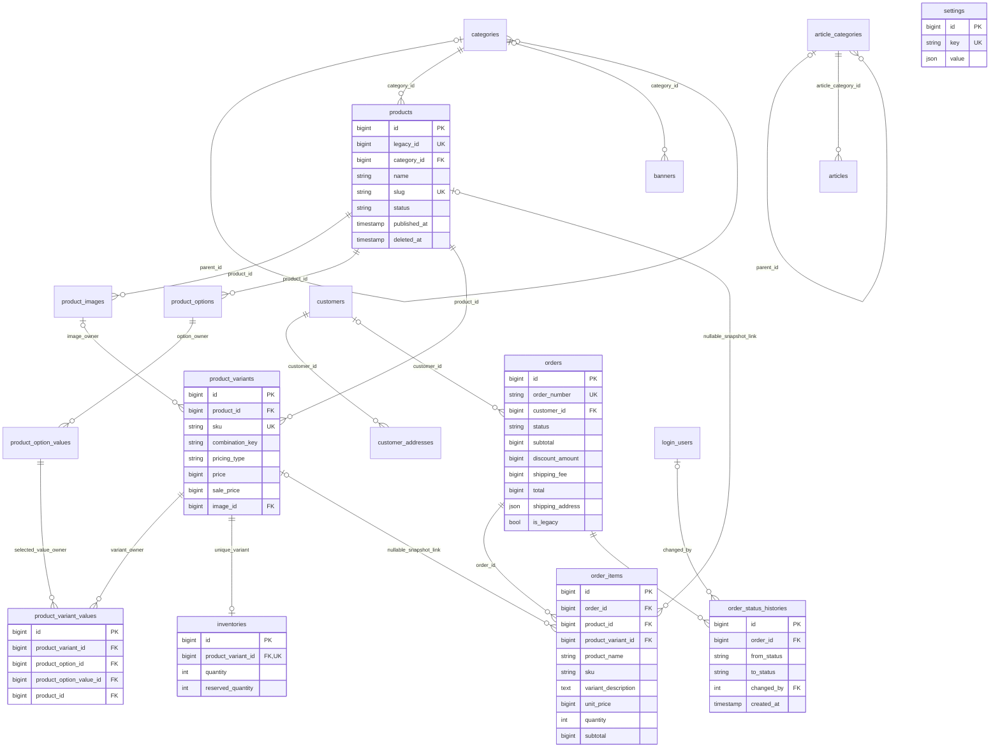

# Database design và ERD — Phase 1

Nguồn thực thi: [migration](../database/migrations/2026_10_27_000001_create_store_domain_tables.php), [models](../app/Models), [schema metadata](phase-1/evidence/schema.json). Có **17 bảng nghiệp vụ**, ngoài các bảng framework/platform do Laravel/Exment tạo. Không copy schema CodeIgniter.

## Conventions

- snake_case plural tables; BIGINT unsigned ID của domain, timestamps, foreignId có FK/index. Exment `login_users.id` là **INT unsigned** nên history.changed_by dùng đúng loại này.
- Null biểu diễn unknown/optional, không dùng empty strings làm ID/giá. Slug unique trong mỗi entity; SKU unique toàn bộ variants, kể cả mã của sản phẩm archived. Canonical route dự kiến `/san-pham/{slug}`, `/danh-muc/{slug}`, `/bai-viet/{slug}`, `/chuyen-muc/{slug}` sẽ chốt ở Phase 3; CSV targets của Phase 0 là draft và phải cập nhật theo slug cuối trước 301.
- Integer VND cho tất cả money; không cast decimal/float. CHECK bảo vệ pricing, order totals/items, inventory bounds và status sets.
- Soft delete chỉ Product; status DRAFT/PUBLISHED/ARCHIVED tách khỏi xóa. Không soft delete history/order items để tránh cảm giác có thể sửa/xóa audit trail.
- `legacy_id` nullable unique trên canonical entities; JSON chỉ dùng shipping-address snapshot và typed setting value, không chứa catalog variants.

## ERD (phản ánh FK thực tế)

DB cho inventory 0..1 do FK+unique; CreateVariant transaction luôn tạo đúng 1 row. Composite FKs có thêm product_id/option_id nhằm chống gắn value hoặc image của product khác, không là JSON hoặc bản sao thông tin nghiệp vụ.

## Tables / important fields

| Table | Fields và quy tắc chính |
| --- | --- |
| categories | parent_id nullable; name/slug; description/image; sort_order/status/featured; meta_title/meta_description/published_at; legacy_id |
| products | category_id; name/slug; short_description/description HTML được sanitize tại create action; status/featured/SEO/published_at; legacy_id; deleted_at. **Không price/stock chính** |
| product_images | product_id/path/alt_text/sort_order/is_primary; generated primary_product_id unique chỉ khi primary để tối đa một ảnh chính/product |
| product_options | product_id/name/sort_order; unique product+name; không hard-code option1/2 |
| product_option_values | option_id/product_id/value/sort_order; unique option+value; composite owner identity |
| product_variants | product_id/sku/combination_key/status/pricing_type/price/sale_price/image_id; legacy_variant_index/legacy_sku; unique product+combination |
| product_variant_values | một value cho mỗi option của variant; unique variant+option; owner FKs dùng cùng product_id |
| inventories | unique product_variant_id; quantity/reserved_quantity unsigned; reserved<=quantity. Không thêm location khi chưa có multi-warehouse verified |
| customers | name/email/phone/status/legacy_id; email/phone indexed **không unique** vì chưa có customer-account identity/dedup policy |
| customer_addresses | customer_id; recipient_name/phone/line1/line2/ward/district/province/country_code/postal_code/label; default marker với generated unique default_customer_id |
| orders | unique order_number ULID-based; nullable customer_id; contact/address snapshot độc lập profile; VND subtotal/discount/shipping/total; status; legacy_id/status/is_legacy |
| order_items | nullable product/variant links; product_name/sku/variant_description/unit_price/quantity/subtotal snapshot. Historical SKU nullable khi nguồn không biết; use case mới luôn có SKU |
| order_status_histories | from nullable cho lần đầu; to/note/changed_by/created_at; không updated_at; model append-only |
| article_categories | adjacency tree; name/slug/description/image/menu/sort/status/SEO/published_at; legacy_id |
| articles | category/title/slug/excerpt/content/image/status/published_at/SEO; menu/featured/view_count; legacy_id |
| banners | gộp banner/slider theo position; category scope nullable; name/image/link/priority/sort/status; starts_at/ends_at nullable; legacy_source+legacy_id composite unique |
| settings | unique key + JSON scalar/text value; chỉ public whitelist qua SetPublicSetting; không là credential store |

CONTACT: price/sale NULL. FIXED: price>0, sale NULL hoặc 0<sale<=price. `quantity>0`, `unit_price>0`, `item.subtotal=unit_price*quantity`; `order.discount<=subtotal`, `total=subtotal-discount+shipping`. Đơn mới subtotal là tổng snapshot lines, không nhận totals từ client. History import không được dùng CreateOrder để tránh repricing/reservation.

## Foreign-key delete policy

| Relationship | Delete behavior / lý do |
| --- | --- |
| Category→parent, Product→Category; ArticleCategory→parent, Article→Category | RESTRICT; không làm mất cây/đổi nhóm dữ liệu đang dùng một cách ngầm định |
| Product→owned images/options; Option→values | CASCADE khi hard cleanup dữ liệu thuộc sở hữu; variants/pivot references có RESTRICT ngăn mất cấu hình đang dùng |
| Variant→Product; Inventory→Variant | RESTRICT; archive Product thay vì hard delete stock/SKU đang hoạt động |
| Variant→image cùng product | RESTRICT; phải gỡ liên kết ảnh có chủ đích trước delete |
| VariantValue→Variant owner | CASCADE; row pivot không có giá trị độc lập |
| VariantValue→OptionValue owner | RESTRICT; không đổi/xóa một option value đang cấu thành SKU |
| CustomerAddress→Customer | CASCADE; address là owned profile data; order giữ snapshot riêng |
| Order→Customer | SET NULL; guest/history vẫn tồn tại khi xóa customer profile |
| OrderItem→Product/Variant | SET NULL; tên/giá/SKU/variant snapshot không mất khi catalog được hard cleanup hợp lệ |
| OrderItem/History→Order | RESTRICT; không cascade xóa lịch sử giao dịch |
| History→Exment LoginUser | SET NULL; history còn khi identity admin bị xóa; không dùng base_user_id làm FK này |
| Banner→Category | RESTRICT; không tự biến banner theo category thành banner global khi category bị xóa |

Chống cycle/self-parent bằng CategoryTreeService có ordered row locks. FK chỉ bảo đảm parent tồn tại, không tự bảo đảm acyclic graph. Hard-delete không có UI/use case tại Phase 1; tests chỉ kiểm FK và bảo toàn snapshot sau safe cleanup.

## Index strategy

- Unique slug trên products/categories/articles/article_categories: lookup canonical nhanh, uniqueness theo entity, không tạo slug registry toàn hệ thống.
- Product browse `(category_id,status,featured,id)`; `(status,published_at)` cho publication. Không thêm index vào HTML descriptions hoặc mọi cột.
- SKU global unique; `(product_id,combination_key)` chống duplicate variants; các composite owner unique indexes là đích bắt buộc cho FK.
- Inventory unique variant; order number unique; orders `(status,created_at)`, `(customer_id,created_at)` và customer_phone phục vụ admin tìm đơn guest.
- Customers email/phone indexed; history `(order_id,created_at)`; article `(article_category_id,status,published_at)`; banners `(position,status,sort_order)`; category `(parent_id,status,sort_order)`.
- Generated nullable unique keys bảo vệ primary image/default address mà vẫn cho nhiều rows không-primary/non-default. Không cần partial indexes hoặc triggers riêng.

Schema mới đã được chạy từ DB trống, rollback toàn bộ (gồm vendor migrations) và migrate lại trên MariaDB thật trong tests. [Test report](phase-1-report.md) ghi bằng chứng và giới hạn. Chưa benchmark/query-plan trên dữ liệu thật; việc đó thuộc Phase 5 sau import staging.

## Integrity review 28/10/2026

Migration additive2026_10_28_000002_harden_money_domain_checks thêm3 CHECKs: variants_money_domain_check (FIXED explicit price IS NOT NULL, positive<=9223372036854775807; saleNULL hoặcpositive<=price; CONTACT cả2NULL), orders_money_domain_check và items_money_domain_check (money<=signed64max). Unsigned SQL BIGINT rộng hơn PHP64-bit int nên CHECK bảo vệ đường bypass/import; không đổi column type, PK, FKs, indexes hoặc old migrations.

Preflight cả3 tables trước ANY DDL, lỗi chỉ count, không tự sửa data. Down drop3 checks mới; MariaDB DDL không hoàn toàn transactional. Existing-data upgrade/down/up/preflight-invalid/no-partial-checks, max boundary và full fresh/rollback/remigrate PASS. Operational local đã migrate sau private dump; dump mới restore riêng NOT TESTED. [Runtime schema](risk-review/evidence/runtime-schema.json), [tests](risk-review/evidence/tests.json), [review](risk-review-report.md).17 domain tables columns/FKs/indexes giữ nguyên, checkout_attempts technical có từ Phase3.

Legacy mapping dùng DRAFT/INACTIVE defaults và quarantine, không làm yếu live constraints để nhận historical rows lỗi. **PHASE 4 STATUS: NOT READY** theo blockers trong [register](risk-register.md); database regression PASS không phải security/browser approval.
