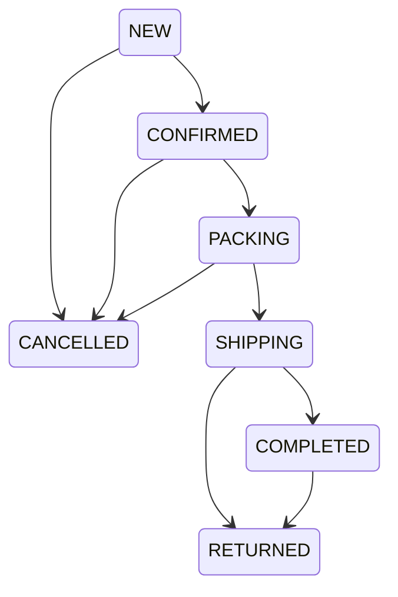

# Workflow đơn hàng — Phase 2

Vào `/admin/plugins/bancay_orders/orders`, cần `commerce.manage`. Tìm mã đơn/tên/điện thoại, lọc 7 status và khoảng ngày, sort mới nhất. Detail lấy tên sản phẩm, SKU, variant, unit price, qty, subtotal từ **order_items snapshot**, không lấy catalog hiện tại để viết đè lịch sử. Customer contact/address cũng là order snapshot.

`CANCELLED` và `RETURNED` là terminal. Không `COMPLETED→NEW/CANCELLED`. UI chỉ cho các transition hợp lệ, service vẫn xác minh lại under lock. Actor lấy từ authenticated Exment LoginUser; note ≤5000; expected_status phát hiện stale form. Không dùng Exment generic Workflow update vì schema native có inventory side effects và history invariant.

| Thao tác | Inventory / history |
| --- | --- |
| CreateOrder (domain, chưa có public checkout) | Server tính giá/snapshot; transaction reserve quantity; history khởi tạo |
| NEW→CONFIRMED→PACKING | Giữ reservation; thêm history đúng actor/time/note |
| NEW/CONFIRMED/PACKING→CANCELLED | Giải phóng reserved một lần; physical không tăng; thêm history |
| PACKING→SHIPPING | Trừ physical và reserved trong cùng transaction với status/history |
| SHIPPING→COMPLETED | Thêm history; không trừ tồn lần hai |
| SHIPPING/COMPLETED→RETURNED | Ghi trạng thái, **không tự restock**. Hàng trả cần kiểm tra thực tế; adjustment riêng có lý do |
| Đơn `is_legacy=true` | Chỉ đọc, không workflow live. Import history có đường riêng Phase 4 |

Money là integer VND, display không qua float. Không cho sửa totals/items/status qua generic PUT hoặc xóa order/history. Xóa mềm catalog không xóa snapshot. FK actor có thể NULL nếu login identity bị native Exment xóa; timeline hiển thị rõ tài khoản không còn tồn tại, không gán lại người khác.

Phase 2 không có public/order-entry form. Đơn để test dùng CreateOrder và fixture tổng hợp. Không có payment/refund/shipping-provider action hoặc email tự động. Stock ledger, restock-return approval, reservation expiry, editable post-order shipping/discount và reconciliation lịch sử giữ trong backlog. CSV Order là summary có contact PII, chỉ role xử lý đơn được tải.
